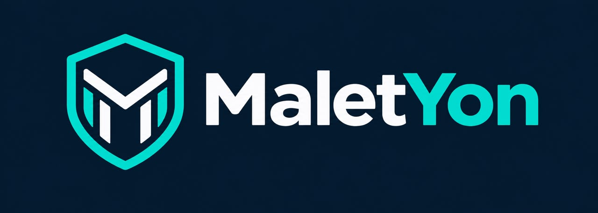

# MaletYon · cours ouverts en gouvernance, audit, sécurité et investigation numérique

*Malet Yon* signifie « ton enseignant » en bassa. Ce compte publie les cours universitaires de **MINKA MI NGUIDJOÏ Thierry Emmanuel**, enseignant-chercheur (LIMSI, École Nationale Supérieure Polytechnique de l'Université de Yaoundé I), auditeur des systèmes d'information et expert judiciaire.

Chaque cours est un traité complet, rédigé en LaTeX, avec ses présentations et ses fiches d'auto-évaluation par chapitre. Tous sont ancrés à la fois dans les normes internationales (ISO, ISACA, IIA, INTOSAI, NIST, FIRST) et dans le droit camerounais et africain, avec des cas fictifs situés au Cameroun.

Contact : [maletyon@proton.me](mailto:maletyon@proton.me)

##  Mes cas pratiques

Tous les cours travaillent sur les mêmes organisations fictives : LiZbiZ, la BANQUE SANAGA, l'ANPP, NYANGA CRÉDIT, NOUN PAY, le CENTRE MÉDICAL MBOLO, KRIBILOG et quelques autres. Une entreprise attaquée dans le cours de sécurité est auditée dans le cours d'audit, reconstruite dans le cours de gestion des risques, puis testée dans le cours de hacking éthique. Ce recueil présente chacune en détail : fiche d'identité, personnes, chronologie, puis les cours et les chapitres où elle apparaît, avec ce que le cas y enseigne.

Tout y est fictif et conçu à des fins pédagogiques. Toute ressemblance avec des personnes, des faits ou des entreprises réels serait purement fortuite.

| Recueil | Contenu | Cours couverts | Dossier | Livre |
|---|---|---|---|---|
| Mes cas pratiques | 12 organisations, 4 cabinets, 15 prestataires et partenaires, 11 affaires d'investigation | Les 16 cours | [cas-pratiques](https://github.com/maletyon/maletyon/tree/main/cas-pratiques) | [PDF](https://github.com/maletyon/maletyon/blob/main/cas-pratiques/Mes_cas_pratiques.pdf) · [télécharger](https://github.com/maletyon/maletyon/raw/main/cas-pratiques/Mes_cas_pratiques.pdf) |

## Les cours

### <a href="https://polytechnique.cm/"></a> École Nationale Supérieure Polytechnique de l'Université de Yaoundé I

Département de Génie Informatique, 60 heures par cours (30 séances de 2 heures).

| Cours | UE | Niveau | Dépôt | Livre |
|---|---|---|---|---|
| Sécurité Informatique (SIF) | SEC3266 | HN3 | [cours-sif](https://github.com/maletyon/cours-sif) | [PDF](https://github.com/maletyon/cours-sif/blob/main/SIF_main.pdf) |
| Audit des Systèmes d'Information (ASI) | INF3226 | HN3 | [cours-asi](https://github.com/maletyon/cours-asi) | [PDF](https://github.com/maletyon/cours-asi/blob/main/ASI_main.pdf) |
| Analyse des Risques et Gestion de Crise (ARGC) | GES4062 | HN4 | [cours-argc](https://github.com/maletyon/cours-argc) | [PDF](https://github.com/maletyon/cours-argc/blob/main/ARGC_main.pdf) |
| Introduction à l'Investigation Numérique (IIN) | SEC4031 | HN4 | [cours-iin](https://github.com/maletyon/cours-iin) | [PDF](https://github.com/maletyon/cours-iin/blob/main/IIN_main.pdf) |
| Investigation Numérique Avancée (INA) | SEC4052 | HN4 | [cours-ina](https://github.com/maletyon/cours-ina) | [PDF](https://github.com/maletyon/cours-ina/blob/main/INA_main.pdf) |
| Hacking Éthique II (HE2) | SEC4062 | HN4 | [cours-he2](https://github.com/maletyon/cours-he2) | [PDF](https://github.com/maletyon/cours-he2/blob/main/HE2_main.pdf) |

### <a href="https://www.unescochaire-tic.org/"></a> Chaire UNESCO d'Afrique Centrale ACCES-TIC

Masters professionnels sous la tutelle académique de l'ENSP de Yaoundé, 30 heures par cours.

| Cours | UE | Master | Dépôt | Livre |
|---|---|---|---|---|
| IT Governance, COBIT et ITIL (GCI) | MSN-2S3-MSI03 | Management des Systèmes d'Information | [cours-gci](https://github.com/maletyon/cours-gci) | [PDF](https://github.com/maletyon/cours-gci/blob/main/GCI_main.pdf) |
| Audit et Contrôle Interne des SI (ACSI) | MSN-2S3-MSI05 | Management des Systèmes d'Information | [cours-acsi](https://github.com/maletyon/cours-acsi) | [PDF](https://github.com/maletyon/cours-acsi/blob/main/ACSI_main.pdf) |
| Stratégie numérique et schéma directeur SI (SNSD) | MSN-2S4-MSI01 | Management des Systèmes d'Information | [cours-snsd](https://github.com/maletyon/cours-snsd) | [PDF](https://github.com/maletyon/cours-snsd/blob/main/SNSD_main.pdf) |
| Forensics et Analyse de Vulnérabilités (FAV) | MSN-2S3-SEC07 | Sécurité des Systèmes Numériques | [cours-fav](https://github.com/maletyon/cours-fav) | [PDF](https://github.com/maletyon/cours-fav/blob/main/FAV_main.pdf) |
| Normes, Gestion des Risques et Audit de Cybersécurité (NRAC) | MSN-2S3-SEC08 | Sécurité des Systèmes Numériques | [cours-nrac](https://github.com/maletyon/cours-nrac) | [PDF](https://github.com/maletyon/cours-nrac/blob/main/NRAC_main.pdf) |
| Audit de Protection des Données et Conformité (APDC) | MSN-2S4-SEC02 | Sécurité des Systèmes Numériques | [cours-apdc](https://github.com/maletyon/cours-apdc) | [PDF](https://github.com/maletyon/cours-apdc/blob/main/APDC_main.pdf) |

### <a href="https://pssfp.org/"></a> Programme Supérieur de Spécialisation en Finances Publiques, Université de Yaoundé II

Master professionnel en finances publiques, spécialité Audit et Contrôle, 8 journées de 4 heures.

| Cours | UE | Public | Dépôt | Livre |
|---|---|---|---|---|
| Contrôle et Audit des Systèmes d'Information (CASI) | CAS3401 | Auditeurs des finances publiques | [cours-casi](https://github.com/maletyon/cours-casi) | [PDF](https://github.com/maletyon/cours-casi/blob/main/CASI_main.pdf) |

### <a href="https://univ-garoua.cm/faculte-des-sciences"></a> Université de Garoua

Faculté des Sciences, Département de Mathématiques et Informatiques, Master Professionnel en Sécurité des Systèmes Informatiques et des Données, 30 heures par cours.

| Cours | UE | Dépôt | Livre |
|---|---|---|---|
| Supervision, Analyse Forensique et Gestion des Incidents (SAFI) | SIS589 | [cours-safi](https://github.com/maletyon/cours-safi) | [PDF](https://github.com/maletyon/cours-safi/blob/main/SAFI_main.pdf) |
| Forensique Numérique (FORN) | LPI342 | [cours-forn](https://github.com/maletyon/cours-forn) | [PDF](https://github.com/maletyon/cours-forn/blob/main/FORN_main.pdf) |
| Systèmes de Gestion de la Sécurité Informatique (SGSI) | SIS498 | [cours-sgsi](https://github.com/maletyon/cours-sgsi) | [PDF](https://github.com/maletyon/cours-sgsi/blob/main/SGSI_main.pdf) |

###  Institut Africain d'Informatique, Représentation du Cameroun (IAI-Cameroun)

Formation des OPJ & APJ en investigation numérique et lutte contre la cybercriminalité, 280 heures (40 journées de 7 heures).

| Formation | Sigle | Public | Dépôt | Livre |
|---|---|---|---|---|
| Investigation Numérique & Lutte contre la Cybercriminalité | OPJ-APJ | Officiers et agents de police judiciaire | [cours-opj-apj](https://github.com/maletyon/cours-opj-apj) | Accès réservé |

## Parcours conseillés

- **Audit et contrôle** : [SIF](https://github.com/maletyon/cours-sif), puis [ASI](https://github.com/maletyon/cours-asi), ou leurs versions de master [ACSI](https://github.com/maletyon/cours-acsi) et [CASI](https://github.com/maletyon/cours-casi) ; gouvernance avec [GCI](https://github.com/maletyon/cours-gci), stratégie numérique et schéma directeur avec [SNSD](https://github.com/maletyon/cours-snsd) ; normes et risques avec [NRAC](https://github.com/maletyon/cours-nrac) et [ARGC](https://github.com/maletyon/cours-argc) ; protection des données et conformité à la loi n° 2024/017 avec [APDC](https://github.com/maletyon/cours-apdc).
- **Investigation numérique** : [IIN](https://github.com/maletyon/cours-iin), puis [INA](https://github.com/maletyon/cours-ina) ; au master, [FORN](https://github.com/maletyon/cours-forn), [SAFI](https://github.com/maletyon/cours-safi) et [FAV](https://github.com/maletyon/cours-fav).
- **Sécurité offensive et défensive** : [SIF](https://github.com/maletyon/cours-sif), [HE2](https://github.com/maletyon/cours-he2), [SGSI](https://github.com/maletyon/cours-sgsi) ; l'analyse et la gestion des vulnérabilités avec [FAV](https://github.com/maletyon/cours-fav).

## Architecture d'un dépôt de cours

Tous les dépôts `cours-<sigle>` ont la même structure :

```text
cours-<sigle>/
├── README.md               description, plan, labs, compilation
├── LICENSE.md              CC BY-NC-SA 4.0 (contenu), MIT (code)
├── .gitignore              exclut corrigés, normes sous licence et fichiers de compilation
├── <SIGLE>_main.pdf        le livre compilé
├── <SIGLE>_main.tex        le document maître
├── Style_<SIGLE>.sty       la feuille de style
├── front/                  page de titre, avant-propos, mode d'emploi
├── partie0/ … partieN/     les chapitres, un fichier par chapitre
├── annexes/                glossaire, outils, modèles, textes, contacts
├── bibliographie/          références (biber)
├── figures/                logos et illustrations
├── fiches/                 une fiche d'auto-évaluation par chapitre (texte brut)
├── Présentation/           la vision globale du cours, puis une présentation par séance
│   └── _sources/           le générateur (Python, python-pptx)
├── ndap-sukulu/            la salle de classe compagnon
│   ├── index.html          l'édition en ligne (GitHub Pages)
│   ├── NDAP_SUKULU_<SIGLE>.html           l'édition en un seul fichier
│   ├── NDAP_SUKULU_<SIGLE>_ordinateur.zip l'édition hors ligne à télécharger
│   ├── telephone/          l'édition pour téléphone
│   ├── cours/              le livre en PDF, consultable dans la plateforme
│   ├── labs/               un dossier par lab : énoncé, pièces, manifeste SHA-256
│   └── README.md           mode d'emploi de la plateforme
└── correction/README.md    comment obtenir le livret des corrigés
```

## Les corrigés

Les livrets de correction (corrigés des exercices et des fiches) sont réservés aux enseignants et aux étudiants qui ont rendu leur travail. Ils ne sont pas publics. Pour les obtenir, écrivez à [maletyon@proton.me](mailto:maletyon@proton.me) en précisant votre nom, votre établissement et l'usage prévu.

## NDAP SUKULU, la salle de classe compagnon

### Le principe

*Ndap sukulu* signifie « la salle de classe » en bassa. NDAP SUKULU est l'environnement d'évaluation des cours : une fiche de 20 questions tirées d'une banque de 100 par chapitre, et des laboratoires sur pièces, minutés et en nombre de tentatives limité. Chaque cours a son module autonome, utilisable en ligne, sur ordinateur sans Internet ou sur téléphone, dans le dossier `ndap-sukulu/` de son dépôt. Modules en ligne : [IIN](https://github.com/maletyon/cours-iin/tree/main/ndap-sukulu), [GCI](https://github.com/maletyon/cours-gci/tree/main/ndap-sukulu), [CASI](https://github.com/maletyon/cours-casi/tree/main/ndap-sukulu), [ACSI](https://github.com/maletyon/cours-acsi/tree/main/ndap-sukulu), [FAV](https://github.com/maletyon/cours-fav/tree/main/ndap-sukulu), [APDC](https://github.com/maletyon/cours-apdc/tree/main/ndap-sukulu), [NRAC](https://github.com/maletyon/cours-nrac/tree/main/ndap-sukulu), [ARGC](https://github.com/maletyon/cours-argc/tree/main/ndap-sukulu), [ASI](https://github.com/maletyon/cours-asi/tree/main/ndap-sukulu), [SIF](https://github.com/maletyon/cours-sif/tree/main/ndap-sukulu), [INA](https://github.com/maletyon/cours-ina/tree/main/ndap-sukulu), [HE2](https://github.com/maletyon/cours-he2/tree/main/ndap-sukulu), [FORN](https://github.com/maletyon/cours-forn/tree/main/ndap-sukulu), [SGSI](https://github.com/maletyon/cours-sgsi/tree/main/ndap-sukulu), [SAFI](https://github.com/maletyon/cours-safi/tree/main/ndap-sukulu), [SNSD](https://github.com/maletyon/cours-snsd/tree/main/ndap-sukulu). Les fiches de chaque chapitre restent fournies au format texte dans le dossier `fiches/` de chaque dépôt.

### Essayer avec le compte de démonstration

Chaque module NDAP SUKULU est protégé par les comptes des étudiants inscrits de l'année. Pour permettre à chacun de l'essayer, un compte de démonstration unique est ouvert dans tous les cours, à l'exception de la formation OPJ-APJ, réservée à ses inscrits :

| Matricule | Mot de passe | Nom affiché |
|---|---|---|
| `ETU001` | `eTU001` | ETUDIANT DEMO |

Ce compte donne accès aux fiches et aux labs de chaque cours, avec des tentatives illimitées. Les essais restent dans le navigateur de la personne qui l'utilise : ils ne sont jamais transmis à l'enseignant et n'entrent dans aucune statistique de la salle de classe. Le compte ne donne accès ni aux corrigés ni à l'espace enseignant.

Pour rejoindre la salle de classe d'un cours, utilisez le bouton « Demander mon inscription » du module : il prépare un courriel à l'adresse maletyon@proton.me, à compléter par votre nom, votre établissement et votre matricule.

## Recherche

La méthode des cours d'audit et d'investigation s'appuie sur le programme de recherche de l'**auditologie**, science appliquée de la réduction de l'incertitude dans l'audit des systèmes d'information : [*Vers l'auditologie*](https://hal.science/hal-05701007) (prépublication, HAL) et l'instrument de réponse OUI / NON / NEK ([hal-05701270](https://hal.science/hal-05701270)). Le cours FAV transpose cet instrument à l'enquête numérique : chaque conclusion y est cotée, et l'incertitude d'une enquête se mesure par μ, U et H.

## Licence

Contenu pédagogique sous licence [Creative Commons BY-NC-SA 4.0](https://creativecommons.org/licenses/by-nc-sa/4.0/deed.fr) ; code sous licence MIT. Les normes sous licence (ISO, ISO/IEC, COBIT…) citées dans les cours ne sont jamais fournies. Les logos appartiennent à leurs institutions.

## Déclaration d’utilisation de l’intelligence artificielle

La préparation de ces cours a fait appel à un outil d’intelligence artificielle générative, Opus 5 de Claude (Anthropic), utilisé au moyen de Claude Code en 2025 et 2026. L’outil a servi comme ASSISTANT à la mise en forme LaTeX, à la recherche et à la validation des références, à la standardisation et à l’harmonisation de toutes les diapositives sous un modèle unique, à la validation des questions d’évaluation, et a fourni une aide précieuse dans le développement du code de la plateforme NDAP SUKULU.

La conception des cours, leur plan, le choix des cas, des normes et des textes juridiques cités relèvent de l’auteur. Chaque contenu amélioré avec l’aide de l’outil a été relu, corrigé et validé par l’auteur, qui en assume seul la responsabilité scientifique, pédagogique et juridique.

© MaletYon 2026
