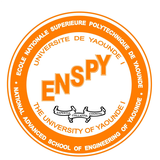
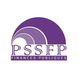

# MaletYon · cours ouverts en audit, sécurité et investigation numérique

*Malet Yon* signifie « ton enseignant » en bassa. Ce compte publie les cours universitaires de **MINKA MI NGUIDJOÏ Thierry Emmanuel**, enseignant-chercheur (LIMSI, École Nationale Supérieure Polytechnique de l'Université de Yaoundé I), auditeur des systèmes d'information et expert judiciaire.

Chaque cours est un traité complet, rédigé en LaTeX, avec ses présentations et ses fiches d'auto-évaluation par chapitre. Tous sont ancrés à la fois dans les normes internationales (ISO, ISACA, IIA, INTOSAI, NIST) et dans le droit camerounais et africain, avec des cas fictifs situés au Cameroun.

Contact : [maletyon@proton.me](mailto:maletyon@proton.me)

## Les cours

### <a href="https://polytechnique.cm/"></a> École Nationale Supérieure Polytechnique de l'Université de Yaoundé I

Département de Génie Informatique, 60 heures par cours (30 séances de 2 heures).

| Cours | UE | Niveau | Dépôt | Livre |
|---|---|---|---|---|
| Sécurité Informatique (SIF) | SEC3266 | HN3 | [cours-sif](https://github.com/maletyon/cours-sif) | [PDF](https://github.com/maletyon/cours-sif/blob/main/SIF_main.pdf) |
| Audit des Systèmes d'Information (ASI) | INF3226 | HN3 | [cours-asi](https://github.com/maletyon/cours-asi) | [PDF](https://github.com/maletyon/cours-asi/blob/main/ASI_main.pdf) |
| Analyse des Risques et Gestion de Crise (ARGC) | GES4062 | HN4 | [cours-argc](https://github.com/maletyon/cours-argc) | [PDF](https://github.com/maletyon/cours-argc/blob/main/ARGC_main.pdf) |
| Introduction à l'Investigation Numérique (IIN) | SEC4031 | HN4 | [cours-iin](https://github.com/maletyon/cours-iin) | [PDF](https://github.com/maletyon/cours-iin/blob/main/IIN_main.pdf) |
| Investigation Numérique Avancée (INA) | SEC4052 | HN4 | [cours-ina](https://github.com/maletyon/cours-ina) | [PDF](https://github.com/maletyon/cours-ina/blob/main/INA_main.pdf) |
| Hacking Éthique II (HE2) | SEC4062 | HN4 | [cours-he2](https://github.com/maletyon/cours-he2) | [PDF](https://github.com/maletyon/cours-he2/blob/main/HE2_main.pdf) |

### <a href="https://www.unescochaire-tic.org/"></a> Chaire UNESCO d'Afrique Centrale ACCES-TIC

Masters professionnels sous la tutelle académique de l'ENSP de Yaoundé, 30 heures par cours.

| Cours | UE | Master | Dépôt | Livre |
|---|---|---|---|---|
| IT Governance, COBIT et ITIL (GCI) | MSN-2S3-MSI03 | Management des Systèmes d'Information | [cours-gci](https://github.com/maletyon/cours-gci) | [PDF](https://github.com/maletyon/cours-gci/blob/main/GCI_main.pdf) |
| Audit et Contrôle Interne des SI (ACSI) | MSN-2S3-MSI05 | Management des Systèmes d'Information | [cours-acsi](https://github.com/maletyon/cours-acsi) | [PDF](https://github.com/maletyon/cours-acsi/blob/main/ACSI_main.pdf) |
| Normes, Gestion des Risques et Audit de Cybersécurité (NRAC) | MSN-2S3-SEC08 | Sécurité des Systèmes Numériques | [cours-nrac](https://github.com/maletyon/cours-nrac) | [PDF](https://github.com/maletyon/cours-nrac/blob/main/NRAC_main.pdf) |

### <a href="https://pssfp.org/"></a> Programme Supérieur de Spécialisation en Finances Publiques, Université de Yaoundé II

Master professionnel en finances publiques, spécialité Audit et Contrôle, 8 journées de 4 heures.

| Cours | UE | Public | Dépôt | Livre |
|---|---|---|---|---|
| Contrôle et Audit des Systèmes d'Information (CASI) | CAS3401 | Auditeurs des finances publiques | [cours-casi](https://github.com/maletyon/cours-casi) | [PDF](https://github.com/maletyon/cours-casi/blob/main/CASI_main.pdf) |

### <a href="https://univ-garoua.cm/faculte-des-sciences"></a> Université de Garoua

Faculté des Sciences, Département de Mathématiques et Informatiques, Master Professionnel en Sécurité des Systèmes Informatiques et des Données, 30 heures par cours.

| Cours | UE | Dépôt | Livre |
|---|---|---|---|
| Supervision, Analyse Forensique et Gestion des Incidents (SAFI) | SIS589 | [cours-safi](https://github.com/maletyon/cours-safi) | [PDF](https://github.com/maletyon/cours-safi/blob/main/SAFI_main.pdf) |
| Forensique Numérique (FORN) | LPI342 | [cours-forn](https://github.com/maletyon/cours-forn) | [PDF](https://github.com/maletyon/cours-forn/blob/main/FORN_main.pdf) |
| Systèmes de Gestion de la Sécurité Informatique (SGSI) | IS498 | [cours-sgsi](https://github.com/maletyon/cours-sgsi) | [PDF](https://github.com/maletyon/cours-sgsi/blob/main/SGSI_main.pdf) |

## Parcours conseillés

- **Audit et contrôle** : [SIF](https://github.com/maletyon/cours-sif), puis [ASI](https://github.com/maletyon/cours-asi), ou leurs versions de master [ACSI](https://github.com/maletyon/cours-acsi) et [CASI](https://github.com/maletyon/cours-casi) ; gouvernance avec [GCI](https://github.com/maletyon/cours-gci) ; normes et risques avec [NRAC](https://github.com/maletyon/cours-nrac) et [ARGC](https://github.com/maletyon/cours-argc).
- **Investigation numérique** : [IIN](https://github.com/maletyon/cours-iin), puis [INA](https://github.com/maletyon/cours-ina) ; au master, [FORN](https://github.com/maletyon/cours-forn) et [SAFI](https://github.com/maletyon/cours-safi).
- **Sécurité offensive et défensive** : [SIF](https://github.com/maletyon/cours-sif), [HE2](https://github.com/maletyon/cours-he2), [SGSI](https://github.com/maletyon/cours-sgsi).

## Architecture d'un dépôt de cours

Tous les dépôts `cours-<sigle>` ont la même structure :

```text
cours-<sigle>/
├── README.md               description, plan, labs, compilation
├── LICENSE.md              CC BY-NC-SA 4.0 (contenu), MIT (code)
├── <SIGLE>_main.pdf        le livre compilé
├── <SIGLE>_main.tex        le document maître
├── Style_<SIGLE>.sty       la feuille de style
├── front/                  page de titre, avant-propos, mode d'emploi
├── partie0/ … partie6/     les chapitres, un fichier par chapitre
├── annexes/                glossaire, outils, modèles, textes, contacts
├── bibliographie/          références (biber)
├── figures/                logos et illustrations
├── fiches/                 une fiche d'auto-évaluation de 40 questions par chapitre
├── Présentation/           les présentations PowerPoint, une par séance
│   └── _sources/           le générateur (Python, python-pptx)
└── correction/README.md    comment obtenir le livret des corrigés
```

## Les corrigés

Les livrets de correction (corrigés des exercices et des fiches) sont réservés aux enseignants et aux étudiants qui ont rendu leur travail. Ils ne sont pas publics. Pour les obtenir, écrivez à [maletyon@proton.me](mailto:maletyon@proton.me) en précisant votre nom, votre établissement et l'usage prévu.

## NDAP SUKULU, la salle de classe compagnon

*Ndap sukulu* signifie « la salle de classe » en bassa. NDAP SUKULU est l'environnement d'évaluation des cours : une fiche de 20 questions tirées d'une banque de 100 par chapitre, et des laboratoires sur pièces, minutés et en nombre de tentatives limité. Chaque cours a son module autonome, utilisable en ligne, sur ordinateur sans Internet ou sur téléphone, dans le dossier `ndap-sukulu/` de son dépôt. Modules en ligne : [IIN](https://github.com/maletyon/cours-iin/tree/main/ndap-sukulu), [GCI](https://github.com/maletyon/cours-gci/tree/main/ndap-sukulu), [CASI](https://github.com/maletyon/cours-casi/tree/main/ndap-sukulu), [ACSI](https://github.com/maletyon/cours-acsi/tree/main/ndap-sukulu), [NRAC](https://github.com/maletyon/cours-nrac/tree/main/ndap-sukulu), [ARGC](https://github.com/maletyon/cours-argc/tree/main/ndap-sukulu), [ASI](https://github.com/maletyon/cours-asi/tree/main/ndap-sukulu), [SIF](https://github.com/maletyon/cours-sif/tree/main/ndap-sukulu), [INA](https://github.com/maletyon/cours-ina/tree/main/ndap-sukulu), [HE2](https://github.com/maletyon/cours-he2/tree/main/ndap-sukulu), [FORN](https://github.com/maletyon/cours-forn/tree/main/ndap-sukulu), [SGSI](https://github.com/maletyon/cours-sgsi/tree/main/ndap-sukulu) ; les autres suivent. Les fiches de chaque chapitre restent fournies au format texte dans le dossier `fiches/` de chaque dépôt.

## Recherche

La méthode des cours d'audit s'appuie sur le programme de recherche de l'**auditologie**, science appliquée de la réduction de l'incertitude dans l'audit des systèmes d'information : [*Vers l'auditologie*](https://hal.science/hal-05701007) (prépublication, HAL) et l'instrument de réponse OUI / NON / NEK ([hal-05701270](https://hal.science/hal-05701270)).

## Licence

Contenu pédagogique sous licence [Creative Commons BY-NC-SA 4.0](https://creativecommons.org/licenses/by-nc-sa/4.0/deed.fr) ; code sous licence MIT. Les normes sous licence (ISO, ISO/IEC, COBIT…) citées dans les cours ne sont jamais fournies. Les logos appartiennent à leurs institutions.

© MaletYon 2026
